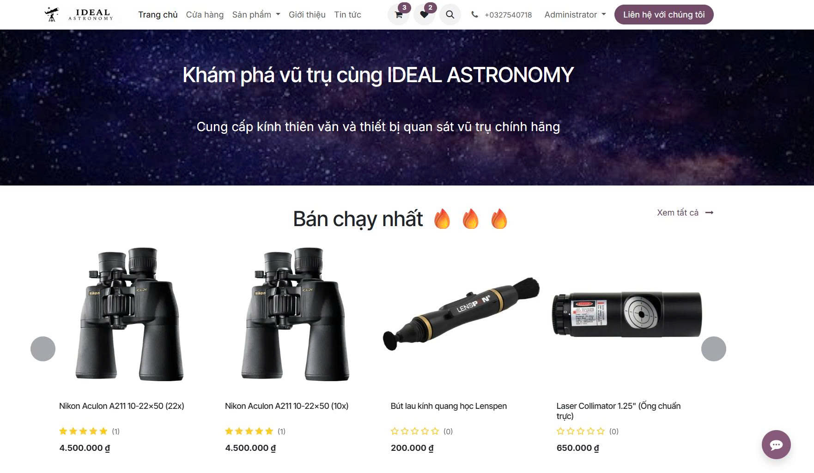
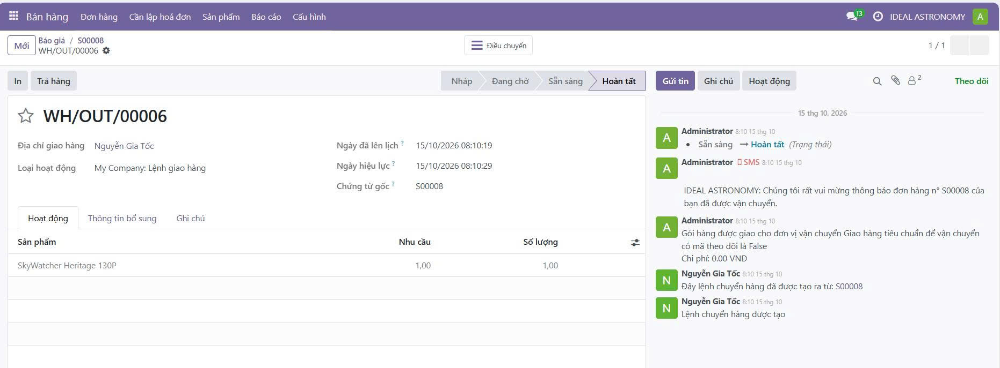

# UI & Configuration Proof

## 1. Storefront Homepage

- Highlights partner branding: Celestron, Orion, ZWO Astronomy).
- Shows customized navigation bar, excess Contact Us button removed (2 Contact Button by default, removed 1).

## 2. Product Catalog & Filtering

- Demonstrates product attributes (Brands) used for sidebar filtering.

## 3. Odoo Backend (Sales Module)

- Demonstrates Quote to Sales Order workflow, delivery generation, and audit trail in the backend.

## 4. Inventory & Fulfillment (`REQ-08`)

- Automated Delivery Order (`WH/OUT`) generated from confirmed Sales Orders with real-time stock reservation.

## 5. Sales Analytics & Reporting (`REQ-10`)

- Built-in graphical reporting dashboard tracking revenue, order volume, and product performance.
