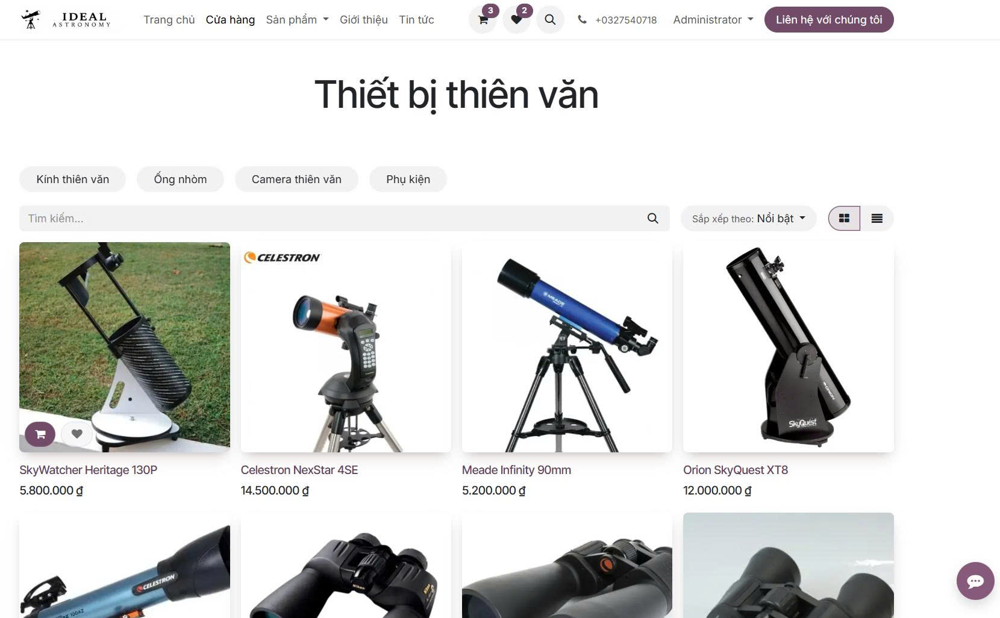
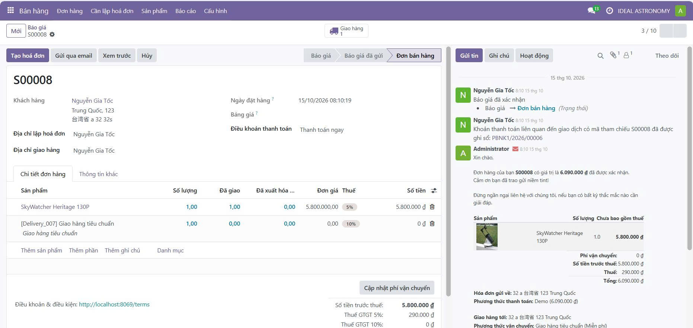
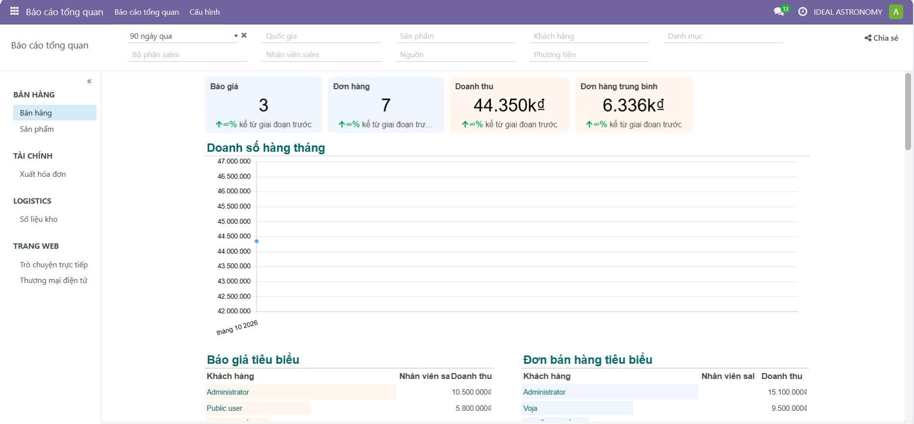

# UI & Configuration Proof

> *Screenshots demonstrating the end-to-end configuration and execution of the Ideal Astronomy Odoo 18 prototype.*

## 1. Storefront Homepage (`REQ-02`, `REQ-03`)

- Highlights official partner branding: Celestron, Orion, ZWO Astronomy.
- Streamlined top navigation bar with the duplicate Contact CTA removed.

## 2. Product Catalog & Attribute Filtering (`REQ-01`)

- Demonstrates categorized astronomy gear and product attribute filtering on the eCommerce storefront.

## 3. Sales Order Processing (`REQ-06`, `REQ-07`, `REQ-09`)

- End-to-end Sales Order (`S00008`) workflow showing Vietnamese VAT calculation (`5%` & `10%`), standard shipping integration, automated confirmation emails, and audit trail.

## 4. Inventory & Automated Fulfillment (`REQ-08`)

- Automated Delivery Order (`WH/OUT/00006`) linked to source document `S00008`, demonstrating stock reservation, delivery validation (`Done`), and automated SMS notification logs.

## 5. Executive Sales Dashboard (`REQ-10`)

- Real-time management dashboard tracking key KPIs: Quotations, Orders, Total Revenue (`44,350k VND`), Average Order Value, and top customer rankings.
